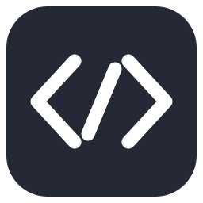

# GPTIDE

想用 GPT 的模型，又习惯了 Cursor 的 IDE，所以做了这个仿 Cursor 的编辑器。

基于 VSCodium，内置 ChatGPT / Codex 编程助手。打开项目就能继续工作，不需要另装聊天插件。



## 使用

Windows 下双击 `启动GPTIDE.cmd`，打开项目文件夹，再从右上角账户入口登录 ChatGPT。使用账户提供的模型与额度，不需要填写 API Key；具体可用模型和用量以账户返回为准。

- 项目独立对话、多标签、置顶与归档，读取本机 Cursor 项目聊天记录。
- Agent 修改代码、选区改写、文件差异查看与 Undo / Keep。
- 模型与思考强度选择、批准方式配置、显眼的用量入口。
- 导入 VS Code 设置与插件，保留熟悉的编辑、终端和 Git 操作。

用量来自本机缓存，会标记更新时间；不会为了刷新用量自动发送模型请求。

## 开发

需要 Node.js 24 和放在 `app/` 下的完整 Windows VSCodium 运行包。

```sh
npm test
npm run build
npm run verify:runtime
npm start
```

版本变化见 [CHANGELOG](CHANGELOG.md)。这是独立的开源编辑器定制项目，与 OpenAI、Cursor 没有官方关联。基础编辑器来自 [VSCodium](https://github.com/VSCodium/vscodium)。
